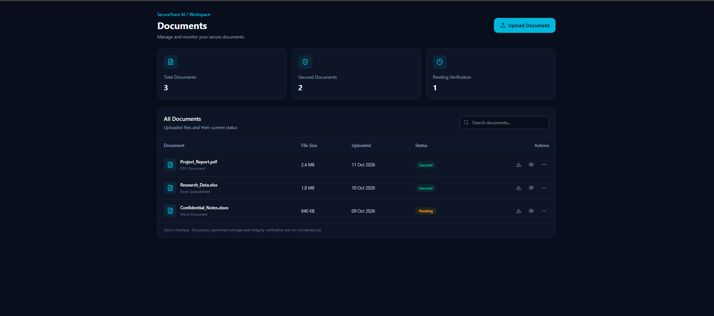
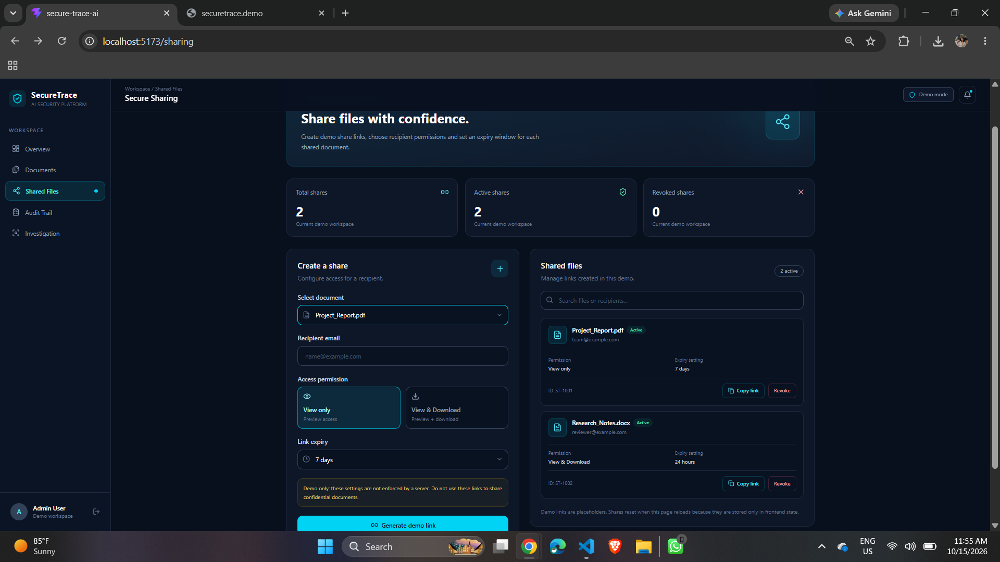

## Development Progress

### 06 October 2026 — Project Initialization

- Initialized React + Vite project
- Configured Tailwind CSS
- Added Lucide React
- Connected project with GitHub
- Verified development environment

### 10 October 2026 — Login UI Frontend Only

- Designed Login and Signup UI
- Added password visibility toggle
- Implemented Login/Signup switching

### 11 October 2026 — Dashboard UI

- Added dashboard layout with sidebar and overview cards
- Added recent activity table and security status panel

### 12 October 2026 — Documents Management UI

- Added Documents page with search and file upload UI
- Implemented file download and preview for uploaded files
- Connected Dashboard navigation to Documents page
- Prepared frontend for future backend integration

### 15 October 2026 — Secure Sharing UI

- Added Secure Sharing page with document selection and recipient email
- Added View Only and View & Download permissions
- Added configurable link expiry options
- Implemented demo link generation, copy and revoke actions
- Added shared files list with search and status cards
- Connected Dashboard navigation to Secure Sharing

