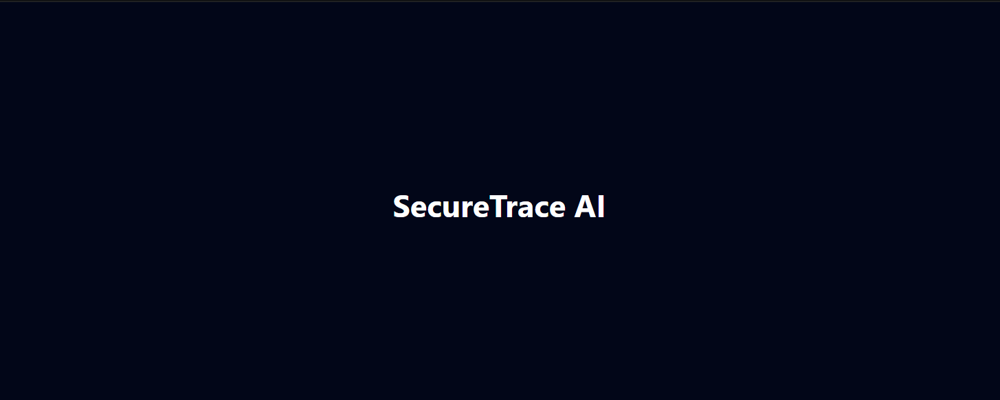
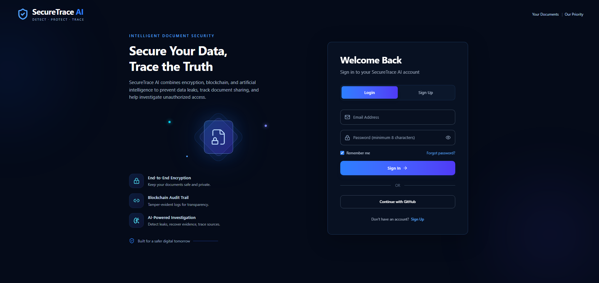
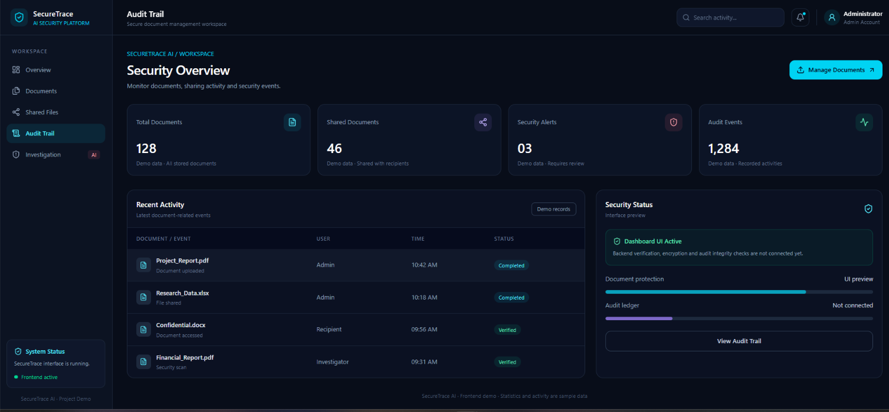

## Development Progress

### 06 October 2026 — Project Initialization

- Initialized React + Vite project
- Configured Tailwind CSS
- Added Lucide React
- Connected project with GitHub
- Verified development environment

### 10 October 2026 - Login UI Frontend only
- Designed Login and Signup UI
- Added password visibility toggle
- Implemented Login/Signup switching

### 11 October 2026 — Dashboard UI

- Added dashboard layout with sidebar and overview cards
- Added recent activity table and security status panel

