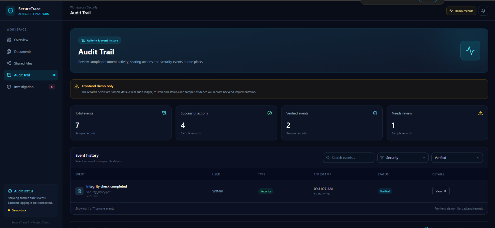

## Development Progress

### 06 October 2026 — Project Initialization

- Initialized React + Vite project
- Configured Tailwind CSS
- Added Lucide React
- Connected project with GitHub
- Verified development environment


### 10 October 2026 — Login UI Frontend Only

- Designed Login and Signup UI
- Added password visibility toggle
- Implemented Login/Signup switching


### 11 October 2026 — Dashboard UI

- Added dashboard layout with sidebar and overview cards
- Added recent activity table and security status panel


### 12 October 2026 — Documents Management UI

- Added Documents page with search and file upload UI
- Implemented file download and preview for uploaded files
- Connected Dashboard navigation to Documents page
- Prepared frontend for future backend integration


### 15 October 2026 — Secure Sharing UI

- Added Secure Sharing page with document selection and recipient email
- Added View Only and View & Download permissions
- Added configurable link expiry options
- Implemented demo link generation, copy and revoke actions
- Added shared files list with search and status cards
- Connected Dashboard navigation to Secure Sharing


### 15 October 2026 — Audit Trail UI

- Created Audit Trail page with demo events
- Added search and filters for audit records
- Implemented event details view
- Fixed navigation between Dashboard and Audit Trail



## Backend Setup

### 19 October 2026 — FastAPI Backend Initialization

- Initialized FastAPI backend
- Configured CORS for React frontend integration
- Added SQLite database connection using SQLAlchemy
- Created initial Document database model
- Added health check API endpoint
- Added `.gitignore` rules for Python environment, local database, uploads, and secrets

### Technologies

- **Frontend:** React, Vite, Tailwind CSS, Lucide React
- **Backend:** Python, FastAPI, Uvicorn
- **Database:** SQLite, SQLAlchemy

### Run the Project Locally

**1. Clone the repository**

```bash
git clone https://github.com/aryanhiremath/Secure_Trace_AI.git
cd Secure_Trace_AI
```

**2. Start the frontend**

```bash
cd frontend
npm install
npm run dev
```

**3. Start the backend**

Open a separate terminal from the project root:

```bash
cd backend
python -m venv venv
```

Activate the virtual environment on Windows PowerShell:

```powershell
.\venv\Scripts\Activate.ps1
```

Install backend dependencies:

```bash
pip install fastapi "uvicorn[standard]" python-multipart sqlalchemy
```

Run the backend:

```bash
uvicorn main:app --reload
```

**Backend URLs**

- Health Check: http://127.0.0.1:8000/api/health
- API Documentation: http://127.0.0.1:8000/docs

### Team Workflow

1. Pull the latest changes before starting work:

   ```bash
   git pull origin main
   ```

2. Create a separate feature branch for new features when possible.
3. Test changes locally before committing.
4. Use meaningful commit messages and push completed changes.
5. Never commit virtual environments, private uploads, database files, or secrets.

**Note:** The backend currently contains the initial API setup and document model. Document upload APIs, authentication, encryption, and secure sharing backend functionality are still to be implemented.

### Document Management API

Implemented document management endpoints using FastAPI, SQLAlchemy, and SQLite.

- `POST /api/documents/upload` — Upload supported documents (maximum 10 MB)
- `GET /api/documents` — Retrieve uploaded document metadata
- `GET /api/documents/{document_id}/download` — Download a stored document
- `GET /api/health` — Check backend health

**Supported file extensions:** PDF, DOC, DOCX, TXT, PNG, JPG, JPEG.

Uploaded files are stored locally in `backend/uploads/`, while their metadata is stored in SQLite.

**Current limitations:** Authentication, authorization, encryption, and production-grade file security are not yet implemented.